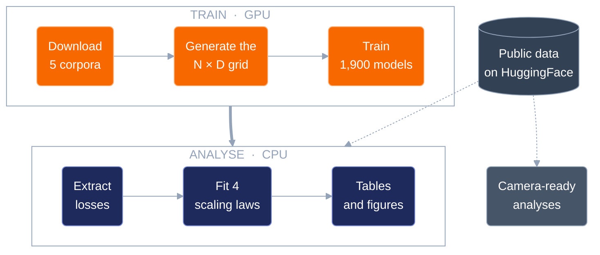

<h1 align="center">Tokens-per-Parameter Coverage Is Critical for<br/>Robust LLM Scaling Law Extrapolation</h1>

<p align="center">
<a href="https://arxiv.org/abs/2605.08541"></a>
<a href="https://neurips.cc/Conferences/2026"></a>
<a href="https://huggingface.co/datasets/leibnitz-lab/colinear_scaling_models"></a>
<a href="LICENSE"></a>
<a href="https://www.python.org/"></a>
<a href="https://docs.astral.sh/uv/"></a>
<a href="https://github.com/astral-sh/ruff"></a>
</p>

<p align="center">
Joshua Shay Kricheli*, Alexander Lawrence Reid*, Soumajyoti Sarkar, Venkata Gandikota, Paulo Shakarian<br/>
<sub>* equal contribution</sub>
</p>

---

- [What is this?](#what-is-this)
- [Installation](#installation)
- [Quick start](#quick-start)
- [Repository structure](#repository-structure)
- [Full pipeline](#full-pipeline)
- [Paper item to command](#paper-item-to-command)
- [Known behaviours](#known-behaviours)
- [Testing](#testing)
- [Citing](#citing)
- [Acknowledgments](#acknowledgments)

# What is this?

The code and data pipeline behind the NeurIPS 2026 paper
[_Tokens-per-Parameter Coverage Is Critical for Robust LLM Scaling Law Extrapolation_](https://arxiv.org/abs/2605.08541).

Scaling laws are fitted on small models and used to predict large ones. Whether such a fit
extrapolates depends on the tokens-per-parameter (TPP) ratios D/N that the training runs cover:

| Collinear (CO) design | Non-collinear (NC) design |
| --- | --- |
| Grows N and D together along a few TPP rays | Spreads the same number of runs over TPP |
| The law's parameters are badly conditioned | The parameters are well conditioned |
| Extrapolates poorly | Wins 97.3% of the extrapolation comparisons |

We test this on about 1,900 trained models over five corpora and four scaling laws, and give a
criterion, computable before any training, that tells which designs are well conditioned.

All the data the analysis needs is public on HuggingFace and needs no account:

- [`leibnitz-lab/colinear_scaling_models`](https://huggingface.co/datasets/leibnitz-lab/colinear_scaling_models) -
  training metrics, checkpoints and pre-computed outputs of every trained model;
- [`leibnitz-lab/public_checkpoint_reanalysis`](https://huggingface.co/datasets/leibnitz-lab/public_checkpoint_reanalysis) -
  run tables of the ten published studies re-analysed in the camera-ready version.

# Installation

[uv](https://docs.astral.sh/uv/) is the only tool needed. One locked environment (Python 3.10)
runs the analysis, the training and the tests.

```bash
git clone https://github.com/lab-v2/tpp-coverage.git && cd tpp-coverage
uv sync
```

# Quick start

Reproduce the paper's tables and figures from the public data, no GPU:

```bash
uv run python src/tpp_analysis/download_and_extract.py --results-only
uv run python src/tpp_analysis/run_analysis.py all --data-dir extracted_losses/ --n-workers "$(nproc)"
uv run python src/tpp_analysis/generate_appendix_tables.py full_coverage_results/
uv run bash src/tpp_analysis/visualizations/run_appendix_figures.sh
```

Add `--clear-cache` to `run_analysis.py` to refit every law from the loss tables; the refit
reproduces the released results bit for bit (about 20 minutes on 50 cores).

# Repository structure



## Layout

Every folder below has one job; a linked folder has its own README.

| Folder | What it holds |
| --- | --- |
| [`src/`](src/README.md) | The importable Python packages |
| `src/tpp_analysis/` | The paper's analysis: corpora, job generation, loss extraction, law fits, tables and figures |
| `src/training_models/` | Llama-style models and the distributed trainer |
| `src/tpp_large_scale/` | The analysis package of `large_scale/` |
| [`camera_ready/`](camera_ready/README.md) | The two analyses added for the camera-ready version |
| [`camera_ready/grid_classification/`](camera_ready/grid_classification/README.md) | The paper's criterion applied to 24 published scaling-law designs |
| [`camera_ready/public_checkpoints/`](camera_ready/public_checkpoints/README.md) | The reanalysis of ten public training-loss releases |
| [`large_scale/`](large_scale/README.md) | The paper's analysis rerun on an independent grid of 461 C4 runs up to 354M parameters |
| [`cluster/`](cluster/README.md) | A larger Wikipedia stratum (to 380.6M parameters) trained on the paper's protocol |
| [`cluster/queue/`](cluster/queue/README.md) | The SLURM task queue that trained it |
| [`cluster/wiki300m/`](cluster/wiki300m/README.md) | Its task generator and the queue of trained cells |
| [`cluster/audit/`](cluster/audit/README.md) | Its re-analyses and their result tables |
| [`docs/`](docs/README.md) | Step-by-step guides: downloading, training, analysis, figures, n-gram KL |
| [`tests/`](tests/README.md) | The pytest suite, one folder per component |
| `.github/` | CI on the project's own runners: tests, `ruff check .`, the privacy scan and the merge rule |
| `images/` | The logos shown in this README |

The experiment folders (`camera_ready/*`, `large_scale/`, `cluster/`) share one layout: a
README saying what the folder holds and how to run it, the scripts, and the committed outputs
in a `results` folder (the grid classification keeps its `results.csv` beside its scripts,
where its pre-registered protocol names it). Their tests sit in `tests/<folder>/`.

# Full pipeline

| Step | Command | Guide |
|---|---|---|
| 1. Download and tokenize the corpora | `src/tpp_analysis/dataset_downloaders/download_{wiki,cosmopedia,redpj,peso,c4}.py` | [TRAINING](docs/TRAINING.md#1-corpora) |
| 2. Write the jobs of the trained grid | `src/tpp_analysis/generate_jobs/generate_jobs.py --dataset <name>` | [TRAINING](docs/TRAINING.md#2-the-trained-grid) |
| 3. Train (4 GPUs per run) | `src/training_models/training/dist_trainer_main.py` under `torchrun` | [TRAINING](docs/TRAINING.md#3-training-one-run) |
| 4. Extract per-epoch losses | `src/tpp_analysis/get_results/get_results.py from_local <metrics dir>` | [DOWNLOADING](docs/DOWNLOADING.md) |
| 5. Fit the laws, write the tables | `run_analysis.py`, `run_special_analysis.py`, `run_prelim_bigtpp.py`, `generate_appendix_tables.py` | [ANALYSIS](docs/ANALYSIS.md) |
| 6. Figures | `run_appendix_figures.sh`, notebooks in `visualizations/` | [VISUALIZATIONS](docs/VISUALIZATIONS.md) |

Steps 1-3 need GPUs (about 3,600 GPU-hours in total). Step 4 can start from the released
metrics: `download_and_extract.py` without `--results-only` fetches them (~0.5 GB).

# Paper item to command

Paths are under `src/tpp_analysis/` unless noted.

| Paper item | Command |
|---|---|
| Main win-rate table (97.3%) and R2/RMSE summary | `run_analysis.py full_coverage` |
| Appendix metrics, fitted parameters, win rate by holdout split | `generate_appendix_tables.py full_coverage_results/` |
| BF16 replication (98.7%) | `run_special_analysis.py`, then `generate_appendix_tables.py special_results/ --special` |
| BigTPP preliminary (63.3%) | `run_prelim_bigtpp.py` |
| Regime-A subset table | `dispatch_seeds.sh 0 21`, `subset_analysis/aggregate_seed_runs.py`, `subset_analysis/per_law_winrate_ci.py --mode first` |
| Figure 1 and appendix three-panel figures | `run_analysis.py seed_variance`, then `visualizations/run_appendix_figures.sh` |
| Architecture table, n-layers figure | `utility/audit_architectures.py`, then `utility/plot_nlayers_distribution.py --mode runs` |
| n-gram KL table | `ngram_analysis/run_all_ngrams.sh` (needs the tokenized corpora) |
| Published-design classification (24 designs) | `camera_ready/grid_classification/classify.py` |
| Public-checkpoint reanalysis | [`camera_ready/public_checkpoints/`](camera_ready/public_checkpoints/README.md) |

The theorems and the severity, eigenvalue and R_min tables are analytic; no script computes them.

# Known behaviours

These produced the paper's numbers.

- **Padding was scored.** In the released runs padded positions counted toward the loss, so
  their reported losses sit below the loss on real tokens. The trainer now masks padding out of
  the loss; `--score-padding` restores the released behaviour, for reproducing a released run.
- **BF16 is a full cast.** `--use-bf16` calls `model.bfloat16()`; only the logits are cast to
  FP32 for the loss.
- **Four GPUs per run.** The learning-rate schedule follows the per-GPU step count, so another
  GPU count trains a different model.
- **One training seed.** Every model is trained with seed 42; the analysis seeds are fitting
  restarts and subset draws.
- **Released runs.** C4 has 321 of its 324 runs; epoch-2 and epoch-3 checkpoints exist for all.

# Testing

```bash
uv run pytest -n auto
```

The suite checks law recovery on synthetic data, every entry point's `--help`, that the
released tables are reproduced, the camera-ready analyses, the README's links, images,
diagram and citation, and that no private host or path is in the tree.

CI runs the suite, `ruff check .` and the privacy scan on every pull request and every push
to `main`. A pull request may merge only when its author is a lab-v2 member, or when a
member approved its latest commit (the `pr-authorization` check).

# Citing

If you use this work, please cite our paper:

```bibtex
@article{kricheli2026tpp,
  title         = {Tokens-per-Parameter Coverage Is Critical for Robust {LLM} Scaling Law Extrapolation},
  author        = {Kricheli, Joshua Shay and Reid, Alexander Lawrence and Sarkar, Soumajyoti and Gandikota, Venkata and Shakarian, Paulo},
  journal       = {arXiv preprint arXiv:2605.08541},
  year          = {2026},
  eprint        = {2605.08541},
  archivePrefix = {arXiv},
  primaryClass  = {cs.LG},
  url           = {https://arxiv.org/abs/2605.08541},
  note          = {Accepted to the 40th Conference on Neural Information Processing Systems (NeurIPS 2026)}
}
```

# Acknowledgments

This work was done at the Leibniz Lab, Department of Electrical Engineering and Computer
Science, Syracuse University. This research was funded by ARO grant W911NF-24-1-0007.
Separately, this work used DeltaAI at NCSA through allocation CIS230318 from the Advanced
Cyberinfrastructure Coordination Ecosystem: Services & Support (ACCESS) program
([Boerner et al., 2023](https://doi.org/10.1145/3569951.3597559)), which is supported by U.S.
National Science Foundation grants #2138259, #2138286, #2138307, #2137603, and #2138296.
Three AMD EPYC CPU chips, donated by AMD, were used for the experiments. This research was
supported in part through computational resources provided by Syracuse University, including
OrangeGrid, which is supported by NSF award ACI-1341006. The code is released under the GNU
General Public License v2 ([`LICENSE`](LICENSE)).

<p align="center">
  <a href="https://www.syracuse.edu/"></a>
  &nbsp;&nbsp;&nbsp;
  <a href="https://ecs.syracuse.edu/academics/electrical-engineering-and-computer-science/">
    <picture>
      <source media="(prefers-color-scheme: dark)" srcset="images/syracuse_ecs_dark.svg">
      
    </picture>
  </a>
  &nbsp;&nbsp;&nbsp;
  <a href="https://leibniz.syracuse.edu/"></a>
</p>
