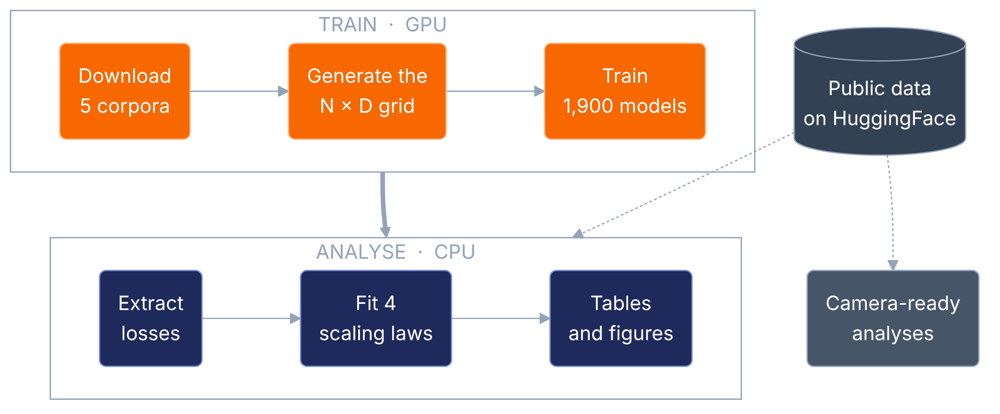

<!-- vague-words-allowed: robust (owner, 2026-11-24: the paper title) -->
<h1 align="center">Tokens-per-Parameter Coverage Is Critical for<br/>Robust LLM Scaling Law Extrapolation</h1>

<p align="center">
<a href="https://arxiv.org/abs/2605.08541"></a>
<a href="https://lab-v2.github.io/tpp-coverage/"></a>
<a href="https://neurips.cc/virtual/2026/loc/sydney/poster/149648"></a>
<a href="https://huggingface.co/datasets/leibnitz-lab/colinear_scaling_models"></a>
<a href="LICENSE"></a>
<a href="https://www.python.org/"></a>
<a href="https://docs.astral.sh/uv/"></a>
<a href="https://github.com/astral-sh/ruff"></a>
</p>

<p align="center">
Joshua Shay Kricheli*, Alexander Lawrence Reid*, Soumajyoti Sarkar, Venkata Gandikota, Paulo Shakarian<br/>
<sub>* equal contribution</sub>
</p>

---

- [What is this?](#what-is-this)
- [Installation](#installation)
- [Quick start](#quick-start)
- [Repository structure](#repository-structure)
- [Full pipeline](#full-pipeline)
- [Known behaviours](#known-behaviours)
- [Testing](#testing)
- [Citing](#citing)
- [Acknowledgments](#acknowledgments)

# What is this?

The code and data pipeline behind the NeurIPS 2026 paper
[_Tokens-per-Parameter Coverage Is Critical for Robust LLM Scaling Law Extrapolation_](https://arxiv.org/abs/2605.08541).

Scaling laws are fitted on small models and used to predict large ones. Whether such a fit
extrapolates depends on the tokens-per-parameter (TPP) ratios D/N that the training runs cover:

| Collinear (CO) design | Non-collinear (NC) design |
| --- | --- |
| Grows N and D together along a few TPP rays | Spreads the same number of runs over TPP |
| The law's parameters are badly conditioned | The parameters are well conditioned |
| Extrapolates poorly | Wins 97.3% of the extrapolation comparisons |

We test this on about 1,900 trained models over five corpora and four scaling laws, and give a
criterion, computable before any training, that tells which designs are well conditioned.

All the data the analysis needs is public on HuggingFace and needs no account:

- [`leibnitz-lab/colinear_scaling_models`](https://huggingface.co/datasets/leibnitz-lab/colinear_scaling_models) -
  training metrics, checkpoints and pre-computed outputs of every trained model;
- [`leibnitz-lab/public_checkpoint_reanalysis`](https://huggingface.co/datasets/leibnitz-lab/public_checkpoint_reanalysis) -
  run tables of the ten published studies re-analysed in the camera-ready version.

# Installation

[uv](https://docs.astral.sh/uv/) is the only tool needed. One locked environment (Python 3.10)
runs the analysis, the training and the tests.

```bash
git clone https://github.com/lab-v2/tpp-coverage.git && cd tpp-coverage
uv sync
```

# Quick start

Reproduce the paper's tables and figures from the public data, no GPU:

```bash
uv run python src/tpp_analysis/download_and_extract.py --results-only
uv run python src/tpp_analysis/run_analysis.py all --data-dir extracted_losses/ --n-workers "$(nproc)"
uv run python src/tpp_analysis/generate_appendix_tables.py full_coverage_results/
uv run bash src/tpp_analysis/visualizations/run_appendix_figures.sh
```

Add `--clear-cache` to `run_analysis.py` to refit every law from the loss tables; the refit
reproduces the released results bit for bit (about 3 minutes on 480 threads; `tests/tpp_analysis/test_paper_numbers.py` checks it).

# Repository structure

<p align="center">

</p>

The diagram's source is [`images/pipeline/pipeline.mmd`](images/pipeline/pipeline.mmd); `images/pipeline/render.sh` renders it.

## Layout

Every folder below has one job; a linked folder has its own README.

| Folder | What it holds |
| --- | --- |
| [`src/`](src/README.md) | The importable Python packages |
| `src/tpp_analysis/` | The paper's analysis: corpora, job generation, loss extraction, law fits, tables and figures |
| `src/training_models/` | Llama-style models and the distributed trainer |
| `src/tpp_large_scale/` | The analysis package of `large_scale/` |
| [`camera_ready/`](camera_ready/README.md) | The two analyses added for the camera-ready version: 24 published designs classified, ten public releases reanalysed |
| [`large_scale/`](large_scale/README.md) | The paper's analysis rerun on an independent grid of 461 C4 runs up to 354M parameters |
| [`cluster/`](cluster/README.md) | A larger Wikipedia stratum (to 380.6M parameters) trained on the paper's protocol |
| [`docs/`](docs/README.md) | Step-by-step guides: downloading, training, analysis, figures, n-gram KL, the public-checkpoint tests, and the known behaviours |
| [`slides/`](slides/README.md) | The five-minute NeurIPS 2026 talk (Beamer source and PDF) |
| [`poster/`](poster/README.md) | The NeurIPS 2026 poster, A0 landscape (beamerposter source and PDF) |
| [`website/`](website/README.md) | The project page at [lab-v2.github.io/tpp-coverage](https://lab-v2.github.io/tpp-coverage/) |
| [`tests/`](tests/README.md) | The pytest suite, one folder per component |
| `.github/` | CI on the project's own runners: tests, pre-commit hooks, `ruff check .`, the privacy scan and the merge rule |
| `images/` | The three logos every asset carries (NeurIPS, the Syracuse AI Institute, the Leibniz Lab), with light copies for dark mode, the pipeline diagram, and the badges (`badges/fetch.sh` renders them from shields.io) |

# Full pipeline

Download, train, extract, fit, tabulate and plot, step by step, with each step's command and
guide, and every table and figure of the paper mapped to its command: [Full pipeline](docs/README.md#full-pipeline).

# Known behaviours

Ten behaviours change a reproduced number when they are missed: padding, BF16, the GPU count,
the seed, the incomplete releases, model sizes, run names, cached fits, start draws and drivers.
Each is in [Known behaviours](docs/KNOWN_BEHAVIOURS.md), with what it changes and what to do.

# Testing

```bash
uv run pytest -n auto
```

What the suite checks, and what CI runs on every pull request: [Tests](tests/README.md).

# Citing

If you use this work, please cite our paper:

```bibtex
@article{kricheli2026tpp,
  title         = {Tokens-per-Parameter Coverage Is Critical for Robust {LLM} Scaling Law Extrapolation},
  author        = {Kricheli, Joshua Shay and Reid, Alexander Lawrence and Sarkar, Soumajyoti and Gandikota, Venkata and Shakarian, Paulo},
  journal       = {arXiv preprint arXiv:2605.08541},
  year          = {2026},
  eprint        = {2605.08541},
  archivePrefix = {arXiv},
  primaryClass  = {cs.LG},
  url           = {https://arxiv.org/abs/2605.08541},
  note          = {Accepted to the 40th Conference on Neural Information Processing Systems (NeurIPS 2026)}
}
```

# Acknowledgments

This work was done at the Leibniz Lab, Department of Electrical Engineering and Computer
Science, Syracuse University. This research was funded by ARO grant W911NF-24-1-0007.
Separately, this work used resources at NCSA through allocation CIS230318 from the Advanced
Cyberinfrastructure Coordination Ecosystem: Services & Support (ACCESS) program
([Boerner et al., 2023](https://doi.org/10.1145/3569951.3597559)), which is supported by U.S.
National Science Foundation grants #2138259, #2138286, #2138307, #2137603, and #2138296.
Three AMD EPYC CPU chips, donated by AMD, were used for the experiments. This research was
supported in part through computational resources provided by Syracuse University (NSF award
ACI-1341006). The code is released under the GNU
General Public License v2 ([`LICENSE`](LICENSE)).

<p align="center">
  <a href="https://neurips.cc/">
    <picture>
      <source media="(prefers-color-scheme: dark)" srcset="images/neurips_dark.svg">
      
    </picture>
  </a>
  &nbsp;&nbsp;&nbsp;
  <a href="https://instituteai.syracuse.edu/">
    <picture>
      <source media="(prefers-color-scheme: dark)" srcset="images/syracuse_ai_institute_dark.svg">
      
    </picture>
  </a>
  &nbsp;&nbsp;&nbsp;
  <a href="https://leibniz.syracuse.edu/"></a>
</p>
