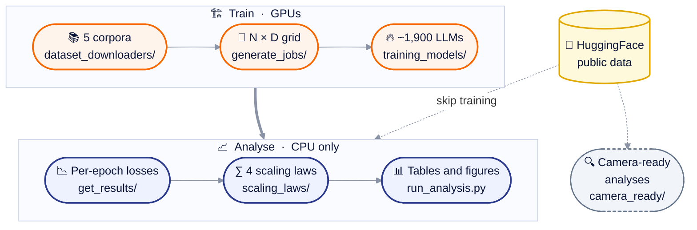

<h1 align="center">Tokens-per-Parameter Coverage Is Critical for<br/>Robust LLM Scaling Law Extrapolation</h1>

<p align="center">
<a href="https://arxiv.org/abs/2605.08541"></a>
<a href="https://neurips.cc/Conferences/2026"></a>
<a href="https://huggingface.co/datasets/TPPIsCriticalFor/colinear_scaling_models"></a>
<a href="LICENSE"></a>
<a href="https://www.python.org/"></a>
<a href="https://docs.astral.sh/uv/"></a>
<a href="https://github.com/astral-sh/ruff"></a>
</p>

<p align="center">
Joshua Shay Kricheli*, Alexander Lawrence Reid*, Soumajyoti Sarkar, Venkata Gandikota, Paulo Shakarian<br/>
<sub>* equal contribution</sub>
</p>

---

- [What is this?](#what-is-this)
- [Installation](#installation)
- [Quick start](#quick-start)
- [Code structure](#code-structure)
- [Full pipeline](#full-pipeline)
- [Paper item to command](#paper-item-to-command)
- [Known behaviours](#known-behaviours)
- [Testing](#testing)
- [Citing](#citing)
- [Acknowledgments](#acknowledgments)

# What is this?

The code and data pipeline behind the NeurIPS 2026 paper
[_Tokens-per-Parameter Coverage Is Critical for Robust LLM Scaling Law Extrapolation_](https://arxiv.org/abs/2605.08541).

Scaling laws are fitted on small models and used to predict large ones. Whether such a fit
extrapolates depends on the tokens-per-parameter (TPP) ratios D/N that the training runs cover:

| Collinear (CO) design | Non-collinear (NC) design |
| --- | --- |
| Grows N and D together along a few TPP rays | Spreads the same number of runs over TPP |
| The law's parameters are badly conditioned | The parameters are well conditioned |
| Extrapolates poorly | Wins 97.3% of the extrapolation comparisons |

We test this on about 1,900 trained models over five corpora and four scaling laws, and give a
criterion, computable before any training, that tells which designs are well conditioned.

All the data the analysis needs is public on HuggingFace and needs no account:

- [`TPPIsCriticalFor/colinear_scaling_models`](https://huggingface.co/datasets/TPPIsCriticalFor/colinear_scaling_models) -
  training metrics, checkpoints and pre-computed outputs of every trained model;
- [`TPPIsCritical/public_checkpoint_reanalysis`](https://huggingface.co/datasets/TPPIsCritical/public_checkpoint_reanalysis) -
  run tables of the ten published studies re-analysed in the camera-ready version.

# Installation

[uv](https://docs.astral.sh/uv/) is the only tool needed. One locked environment (Python 3.10)
runs the analysis, the training and the tests.

```bash
git clone https://github.com/lab-v2/tpp-coverage.git && cd tpp-coverage
uv sync
```

# Quick start

Reproduce the paper's tables and figures from the public data, no GPU:

```bash
uv run python src/tpp_analysis/download_and_extract.py --results-only
uv run python src/tpp_analysis/run_analysis.py all --data-dir extracted_losses/ --n-workers "$(nproc)"
uv run python src/tpp_analysis/generate_appendix_tables.py full_coverage_results/
uv run bash src/tpp_analysis/visualizations/run_appendix_triptychs.sh
```

Add `--clear-cache` to `run_analysis.py` to refit every law from the loss tables; the refit
reproduces the released results bit for bit (about 20 minutes on 50 cores).

# Code structure



| Folder | What it holds |
| --- | --- |
| [`src/training_models/`](src/training_models) | Llama-style models and the distributed trainer |
| [`src/tpp_analysis/`](src/tpp_analysis) | Corpora, job generation, loss extraction, law fitting, tables and figures |
| [`camera_ready/`](camera_ready) | The two analyses added for the camera-ready version |
| [`docs/`](docs) | Step-by-step guides |
| [`tests/`](tests) | The pytest suite |

A one-line map of every top-level folder is in [docs/STRUCTURE.md](docs/STRUCTURE.md).

# Full pipeline

| Step | Command | Guide |
|---|---|---|
| 1. Download and tokenize the corpora | `src/tpp_analysis/dataset_downloaders/download_{wiki,cosmopedia,redpj,peso,c4}.py` | [TRAINING](docs/TRAINING.md#1-corpora) |
| 2. Write the jobs of the trained grid | `src/tpp_analysis/generate_jobs/generate_jobs.py --dataset <name>` | [TRAINING](docs/TRAINING.md#2-the-trained-grid) |
| 3. Train (4 GPUs per run) | `src/training_models/training/dist_trainer_main.py` under `torchrun` | [TRAINING](docs/TRAINING.md#3-training-one-run) |
| 4. Extract per-epoch losses | `src/tpp_analysis/get_results/get_results.py from_local <metrics dir>` | [DOWNLOADING](docs/DOWNLOADING.md) |
| 5. Fit the laws, write the tables | `run_analysis.py`, `run_special_analysis.py`, `run_prelim_bigtpp.py`, `generate_appendix_tables.py` | [ANALYSIS](docs/ANALYSIS.md) |
| 6. Figures | `run_appendix_triptychs.sh`, notebooks in `visualizations/` | [VISUALIZATIONS](docs/VISUALIZATIONS.md) |

Steps 1-3 need GPUs (about 3,600 GPU-hours in total). Step 4 can start from the released
metrics: `download_and_extract.py` without `--results-only` fetches them (~0.5 GB).

# Paper item to command

Paths are under `src/tpp_analysis/` unless noted.

| Paper item | Command |
|---|---|
| Main win-rate table (97.3%) and R2/RMSE summary | `run_analysis.py full_coverage` |
| Appendix metrics, fitted parameters, win rate by holdout split | `generate_appendix_tables.py full_coverage_results/` |
| BF16 replication (98.7%) | `run_special_analysis.py`, then `generate_appendix_tables.py special_results/ --special` |
| BigTPP preliminary (63.3%) | `run_prelim_bigtpp.py` |
| Regime-A subset table | `dispatch_seeds.sh 0 21`, `subset_analysis/aggregate_seed_runs.py`, `subset_analysis/per_law_winrate_ci.py --mode first` |
| Figure 1 and appendix triptychs | `run_analysis.py seed_variance`, then `visualizations/run_appendix_triptychs.sh` |
| Architecture table, n-layers figure | `utility/audit_architectures.py`, then `utility/plot_nlayers_distribution.py --mode runs` |
| n-gram KL table | `ngram_analysis/run_all_ngrams.sh` (needs the tokenized corpora) |
| Published-design classification (24 designs) | `camera_ready/grid_classification/classify.py` |
| Public-checkpoint reanalysis | [`camera_ready/public_checkpoints/`](camera_ready/public_checkpoints/README.md) |

The theorems and the severity, eigenvalue and R_min tables are analytic; no script computes them.

# Known behaviours

These produced the paper's numbers and are kept as they are.

- **Padding is scored.** The cross-entropy has no `ignore_index`, so padded positions count
  toward the loss, and reported losses sit below the loss on real tokens.
- **BF16 is a full cast.** `--use-bf16` calls `model.bfloat16()`; only the logits are cast to
  FP32 for the loss.
- **Four GPUs per run.** The learning-rate schedule follows the per-GPU step count, so another
  GPU count trains a different model.
- **One training seed.** Every model is trained with seed 42; the analysis seeds are fitting
  restarts and subset draws.
- **Released runs.** C4 has 321 of its 324 runs; epoch-2 and epoch-3 checkpoints exist for all.

# Testing

```bash
uv run pytest -n auto
```

The suite checks law recovery on synthetic data, every entry point's `--help`, that the
released tables are reproduced, the camera-ready analyses, the README's links, images,
diagram and citation, and that no private host or path is in the tree.

# Citing

If you use this work, please cite our paper:

```bibtex
@article{kricheli2026tpp,
  title         = {Tokens-per-Parameter Coverage Is Critical for Robust {LLM} Scaling Law Extrapolation},
  author        = {Kricheli, Joshua Shay and Reid, Alexander Lawrence and Sarkar, Soumajyoti and Gandikota, Venkata and Shakarian, Paulo},
  journal       = {arXiv preprint arXiv:2605.08541},
  year          = {2026},
  eprint        = {2605.08541},
  archivePrefix = {arXiv},
  primaryClass  = {cs.LG},
  url           = {https://arxiv.org/abs/2605.08541},
  note          = {Accepted to the 40th Conference on Neural Information Processing Systems (NeurIPS 2026)}
}
```

# Acknowledgments

This work was done at the Leibniz Lab, Department of Electrical Engineering and Computer
Science, Syracuse University. It was funded by ARO grant W911NF-24-1-0007 and NSF ACCESS
grant CIS230318. The code is released under the GNU General Public License v2 ([`LICENSE`](LICENSE)).

<p align="center">
  <a href="https://www.syracuse.edu/"></a>
  &nbsp;&nbsp;&nbsp;
  <a href="https://ecs.syracuse.edu/academics/electrical-engineering-and-computer-science/">
    <picture>
      <source media="(prefers-color-scheme: dark)" srcset="images/syracuse_ecs_dark.svg">
      
    </picture>
  </a>
  &nbsp;&nbsp;&nbsp;
  <a href="https://leibniz.syracuse.edu/"></a>
</p>
