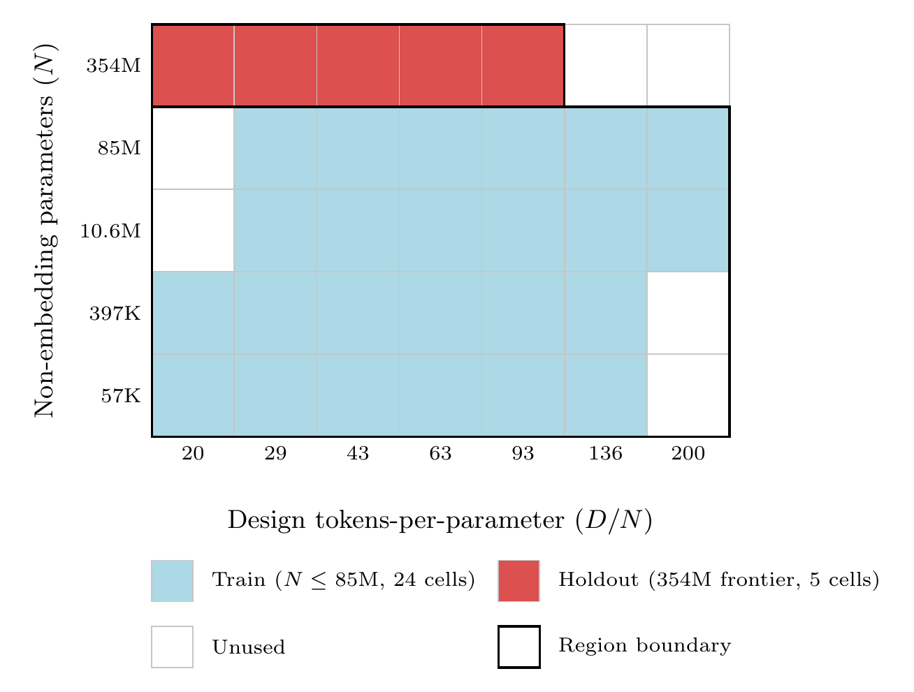
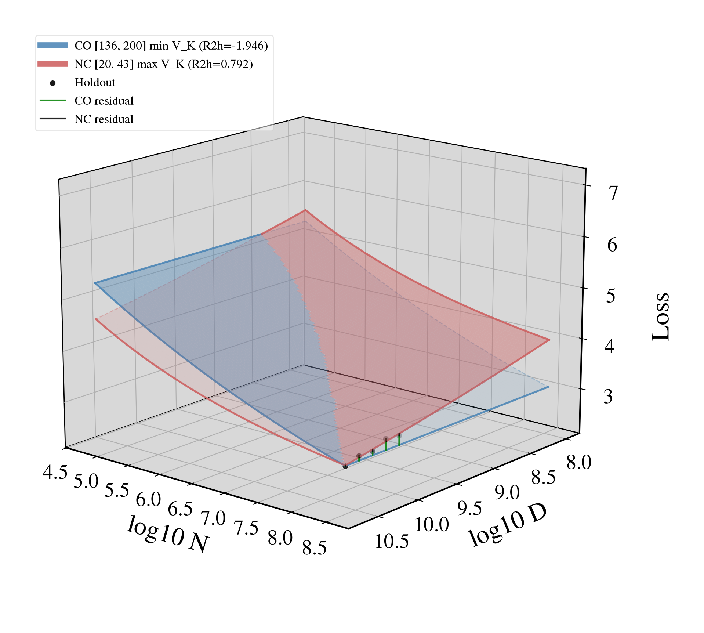
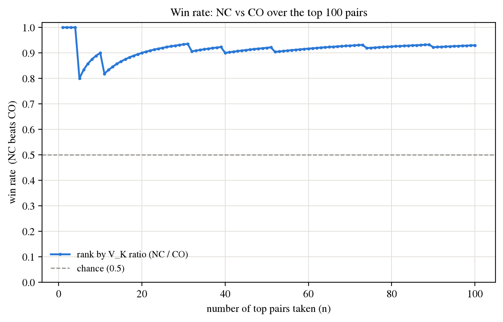

# TPP Coverage at Scale

Large-scale validation of *"Tokens-per-Parameter Coverage Is Critical for Robust LLM Scaling Law
Extrapolation"* ([arXiv 2605.08541](https://arxiv.org/abs/2605.08541)): 461 runs,
models to 354M non-embedding params, C4, TPP 20 to 200. Reuses the paper's own analysis code in
this repository (`src/tpp_analysis`, parity-checked on every run).

## Running it

From the repository root, in the repository's environment (`uv sync`):

```bash
uv run python large_scale/scripts/run_analysis.py               # results/ and figures/
uv run python large_scale/scripts/run_analysis.py --check-only  # parity with the paper's fitters
uv run pytest tests/large_scale -n auto                         # this module's tests
```

The analysis writes `results/results.json` and `results/envelope.csv`; results do not depend on
the worker count (`--workers`). `report.tex` hardcodes its numbers, so after a rerun that moves a
number, compare `results/results.json` against the report's tables before rebuilding
`report.pdf` (`latexmk -pdf report.tex`).

## Layout

| Path | What |
|---|---|
| `data/data_final_metrics.csv` | the grid's per-run final metrics (the analysis input) |
| `scripts/` | the command line (`run_analysis.py`), the CO/NC pair sweep and surface figure, the README math check |
| `results/` | the committed outputs (`results.json`, `envelope.csv`) |
| `figures/` | the committed figures; `figures/tikz/` is the TikZ source of the design-grid figure |
| `report.tex`, `report.pdf` | the written report |
| `UPSTREAM_NOTES.md` | what is reused from the paper's code and what is not, and why |

The analysis package is [`src/tpp_large_scale/`](../src/tpp_large_scale) (`upstream.py`, the one
import point for the paper's code, `config.py`, `model/` for the grid, fits, conditioning and
diversity, `experiments/` for the report sections, `figures.py`, `runner.py`, `cli.py`). Its tests
are [`tests/large_scale/`](../tests/large_scale) (correctness, determinism, pipeline).

## Design grid

5 model sizes x 7 design-TPP targets (D/N_total); a partial grid of 29 cells (each size run at 6 of
7 targets, the largest at 5).

| N (non-embedding) | design-TPP present | cells |
| --- | --- | --- |
| 57K   | 20, 29, 43, 63, 93, 136 | 6 |
| 397K  | 20, 29, 43, 63, 93, 136 | 6 |
| 10.6M | 29, 43, 63, 93, 136, 200 | 6 |
| 85M   | 29, 43, 63, 93, 136, 200 | 6 |
| 354M  | 20, 29, 43, 63, 93 | 5 |



The 29-cell envelope (best-loss run per (N, D)): blue = train (N <= 85M, 24 cells), red = 354M
holdout frontier (5 cells). TikZ port of the paper's appendix grid; source in `figures/tikz/`.

## CO vs NC surface (representative pair)

The pair with the widest R2 margin in the sweep (matched training-cell count, V_K_NC > V_K_CO):
CO = {136, 200} (collinear, V_K = 1.8e-6, kappa_AB ~6e9) and NC = {20, 43} (spread, well-conditioned,
kappa_AB ~120). Each is Chinchilla-fit on the training cells (N <= 85M, 6 each) and extrapolated to
the 354M frontier (holdout, drawn as points with residual sticks), using the paper's
`plot_scaling_law_surface` machinery.



The non-collinear NC tracks the frontier well while the collinear CO does not: holdout R2 +0.78 vs
-1.95. Built by `scripts/build_surface_co_nc.sh` (glue in `scripts/make_surface_co_nc.py`).

## Win rate: non-collinear beats collinear

Notation follows the paper's notation reference (appendix).

**Designs.** The seven design-TPP targets (see Design grid) are the ordered ratios

$$\mathbf{k}^{\mathrm{all}} = (k_1 < \cdots < k_7) = (20,\ 29,\ 43,\ 63,\ 93,\ 136,\ 200).$$

For an index set $S \subseteq \lbrace 1, \ldots, 7\rbrace$ with effective ray count
$K_S = |S| \ge 2$ (the paper's $K$ for a subset design), the collinear subset design over the
training split (the $24$ cells with $N \le 85\text{M}$), new to this grid, is

$$\mathrm{CO}(S) = \lbrace  (N_i, D_i, L_i) \in \mathcal{D}_{\mathrm{train}} : t(i) \in S \rbrace , \qquad t(i) \in \mathrm{argmin}_{\ell \in \lbrace 1, \ldots, 7\rbrace} \left| \log k_\ell - \log ( D_i / N_i^{\mathrm{tot}} ) \right|,$$

where $N^{\mathrm{tot}}$ is the total (embedding-inclusive) parameter count and $N$ the
non-embedding count used in the fit; on this grid the argmin is a singleton for every training
cell, so $t(i)$ is well defined. Cardinality $n_S = |\mathrm{CO}(S)|$; subsets with
$n_S < 6$ are dropped (the Chinchilla law has five parameters).

**Coverage.** Following the paper's holdout $R^2$ proposition,

$$V_{K_S}(S;\ \beta_{\mathrm{eff}}) = \mathrm{Var}\left( \lbrace  k_\ell^{-\beta_{\mathrm{eff}}} : \ell \in S \rbrace  \right), \qquad \beta_{\mathrm{eff}} = 0.971,$$

the paper's fitted Chinchilla data exponent on C4 (appendix fitted-parameter table); larger
$V_{K_S}$ is more diverse coverage.

**Paired comparison.** The paper's budget-matched bounding-box NC pool does not exist on this grid,
so the higher-coverage subset takes the NC role. The win rate below therefore compares two
TPP-subset designs of one grid, not the paper's CO rays against an NC bounding box. The fitter,
the holdout rule and the win-rate definition are the paper's. A pair is two subset designs with

$$n_{S_{\mathrm{CO}}} = n_{S_{\mathrm{NC}}}, \qquad V_{K}(S_{\mathrm{NC}}) > V_{K}(S_{\mathrm{CO}}).$$

Each design is least-squares fit with the Chinchilla law

$$\hat{L}(N, D) = E + A \cdot N^{-\alpha} + B \cdot D^{-\beta}$$

using the paper's fitter ($20$ restarts, fit seed $40$), and scored on the shared holdout
$\mathcal{H}$: the $n_{\mathcal{H}} = 5$ cells at the largest model ($354\text{M}$, beyond the training
range), giving

$$\mathrm{RMSE}_{\mathcal{H}}^{\mathrm{CO}} \quad \text{and} \quad \mathrm{RMSE}_{\mathcal{H}}^{\mathrm{NC}}.$$

Each pair is one comparison $\mathcal{C}$; $\mathcal{P}$ is the set of all $886$ of them.

**Win rate.** Per the paper's definition, for $\mathcal{P}' \subseteq \mathcal{P}$,

$$\mathrm{WR}(\mathcal{P}') = \frac{1}{|\mathcal{P}'|} \sum_{\mathcal{C} \in \mathcal{P}'} \mathbf{1}\lbrace  \mathrm{RMSE}_{\mathcal{H}}^{\mathrm{NC}}(\mathcal{C}) < \mathrm{RMSE}_{\mathcal{H}}^{\mathrm{CO}}(\mathcal{C}) \rbrace ,$$

ties to CO; on a fixed $\mathcal{H}$ this is equivalent to

$$R^{2\ \mathrm{NC}}_{\mathcal{H}} > R^{2\ \mathrm{CO}}_{\mathcal{H}}.$$

**Ranking.** Each comparison $\mathcal{C} = (S_{\mathrm{CO}}, S_{\mathrm{NC}})$ has coverage ratio

$$\rho(\mathcal{C}) = \frac{V_{K}(S_{\mathrm{NC}})}{V_{K}(S_{\mathrm{CO}})} > 1,$$

and $\rho$ takes $886$ distinct values on $\mathcal{P}$, so sorting by $\rho$ descending gives a
unique order (no tie-breaking needed), written

$$\mathcal{C}_{(1)}, \mathcal{C}_{(2)}, \ldots, \mathcal{C}_{(886)}.$$

The figure plots the win rate of the prefix sets

$$\mathcal{P}_n' = \lbrace  \mathcal{C}_{(1)}, \ldots, \mathcal{C}_{(n)} \rbrace$$

against $n = 1, \ldots, 100$: the pairs with the largest coverage ratio, where the ratio forces
$S_{\mathrm{CO}}$ to be genuinely collinear (small denominator) rather than merely less diverse
than $S_{\mathrm{NC}}$.



Over the top $100$ pairs, $\mathrm{WR}(\mathcal{P}')$ stays in $[0.80,\ 0.93]$ (minimum $0.80$, mean
$0.91$), above the chance level $\frac{1}{2}$. Built by `scripts/co_nc_sweep.py`. The
20-restart fits are seed-sensitive, so the fit RNG is pinned (`FIT_SEED = 40`, overridable via
the environment). Another seed moves the holdout RMSEs and with them the curve; the pairs and
their ranking depend on V_K alone and stay the same.
